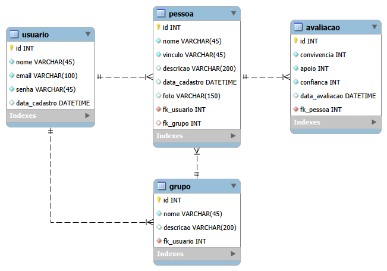

# Documentação do Projeto – ELOS

**Família é quem fica perto. O ELOS mostra quem está.**

| | |
|---|---|
| **Projeto** | ELOS |
| **Aluno** | Daniel Henrique Matos Ferreira |
| **RA** | 01262123 |
| **Turma** | 1ADSB |
| **Curso** | Análise e Desenvolvimento de Sistemas – SPTech |
| **Disciplina** | Pesquisa e Inovação – Projeto Individual 2026/2 |
| **Repositório** | https://github.com/DanielHMF/Projeto-Individual |

---

## 1. Contexto

Família nem sempre é só sangue: é quem a gente escolhe manter por perto. Com o tempo, as pessoas mudam de casa, de rotina e de fase da vida, e as relações mudam junto. Na correria do dia a dia, quase nunca paramos para perceber quem está próximo e de quem estamos nos afastando.

O ELOS é um site onde o usuário cadastra as pessoas importantes para ele, avalia cada relação e vê essas pessoas em um mapa, com ele mesmo no centro. Quanto mais forte o elo, mais perto do centro a pessoa aparece.

## 2. Justificativa

Cresci cercado pela família. A casa da minha vó Rita sempre foi o ponto de encontro de todo mundo, e ao longo da vida a configuração da minha família e dos meus amigos mudou várias vezes: pessoas foram morar em outro lugar, voltaram, se afastaram e se aproximaram de novo. Isso me ensinou que as relações precisam de cuidado e que é fácil deixar alguém importante ficar longe sem perceber.

O ELOS junta as duas coisas que mais fazem parte da minha história: a tecnologia, que me interessa desde o curso de robótica, e as pessoas que estão ao meu redor.

## 3. Objetivos

### Objetivo geral

Desenvolver um site com cadastro, login e dashboard que mostre ao usuário o quanto ele está próximo das pessoas importantes da vida dele.

### Objetivos específicos

- Permitir que o usuário crie uma conta e faça login.
- Permitir cadastrar, editar, excluir e reavaliar pessoas.
- Calcular a **Força do Elo** de cada pessoa, uma nota de 0 a 100.
- Organizar as pessoas em grupos (Família, Amigos, Faculdade, Trabalho e grupos próprios).
- Mostrar indicadores e gráficos que ajudem o usuário a perceber quem merece mais atenção.
- Aplicar o conteúdo de todas as disciplinas do semestre.

## 4. Público-alvo

Pessoas que querem acompanhar e cuidar melhor das suas relações com família, amigos e colegas.

## 5. Escopo

### O que o projeto faz

- Site institucional com propósito, como funciona, sobre mim e inspiração.
- Cadastro e login de usuário.
- Cadastro de pessoas com nome, vínculo, grupo, descrição, foto e avaliação.
- Avaliação em três pilares: convivência, confiança e apoio.
- Histórico de avaliações (a pessoa pode ser reavaliada).
- Edição e exclusão de pessoas.
- Grupos fixos para todos os usuários e grupos criados por cada usuário.
- Dashboard com KPIs, mapa de proximidade e gráficos.
- Perfil com os dados da conta, troca de foto e saída da conta.
- Banco de dados MySQL rodando em uma VM Linux.

### O que o projeto não faz

- Recuperar senha (o link "Esqueci minha senha" ainda não funciona).
- Enviar mensagens ou notificações para as pessoas cadastradas.
- Upload de arquivo de foto: a foto é um link (URL) ou um caminho dentro de `public/imgs/`.
- Conexão entre usuários (cada mapa é individual).

## 6. Requisitos

### Requisitos funcionais

| Código | Requisito | Situação |
|---|---|---|
| RF01 | O usuário deve conseguir criar uma conta com nome, e-mail e senha. | Feito |
| RF02 | O sistema deve validar nome, e-mail, senha forte e confirmação de senha. | Feito |
| RF03 | O usuário deve conseguir fazer login com e-mail e senha. | Feito |
| RF04 | O usuário deve conseguir cadastrar uma pessoa com nome, vínculo, grupo, descrição, foto e as notas dos três pilares. | Feito |
| RF05 | O usuário deve conseguir ver suas pessoas em cards, ordenadas pela Força do Elo. | Feito |
| RF06 | O usuário deve conseguir reavaliar uma pessoa, guardando a avaliação anterior. | Feito |
| RF07 | O usuário deve conseguir editar e excluir uma pessoa. | Feito |
| RF08 | O usuário deve conseguir criar seus próprios grupos. | Feito |
| RF09 | O sistema deve mostrar uma dashboard com KPIs e gráficos. | Feito |
| RF10 | O usuário deve conseguir ver seus dados, trocar a foto e sair da conta. | Feito |
| RF11 | As telas logadas devem mandar para o login quem não estiver logado. | Parcial: feito em Pessoas e Perfil; na Dashboard a verificação está comentada |

### Requisitos não funcionais

| Código | Requisito |
|---|---|
| RNF01 | Usar só as tecnologias do material de apoio: HTML, CSS, JavaScript, Node.js com Express, MySQL e Chart.js. |
| RNF02 | Seguir a arquitetura do web-data-viz (rotas, controllers e models). |
| RNF03 | O banco de dados deve rodar em uma VM Linux. |
| RNF04 | Os erros de formulário devem aparecer na tela, sem `alert`. |
| RNF05 | O código deve ficar no GitHub, com commits frequentes. |
| RNF06 | Senhas e arquivos `.env` não podem ir para o repositório. |
| RNF07 | O site deve seguir a identidade visual do ELOS (paleta Gruta Azul, fontes Nunito e Nunito Sans). |

## 7. Regras de negócio

- **Força do Elo** = média das três notas (convivência, confiança e apoio), arredondada. Ela é calculada na VIEW `vw_elos` e não fica salva em nenhuma tabela.
- Cada nota vai de 0 a 100.
- Quando a pessoa é reavaliada, a avaliação antiga continua no banco. A dashboard e os cards usam sempre a **avaliação mais recente**.
- Um elo com força **abaixo de 50** precisa de atenção.
- No mapa, força 100 fica mais perto do centro e força 0 fica na borda.
- Os grupos com `fk_usuario` nulo (Família, Amigos, Faculdade, Trabalho) aparecem para todos. Os grupos criados pelo usuário aparecem só para ele.
- Para excluir uma pessoa, primeiro são excluídas as avaliações dela, por causa da chave estrangeira.

## 8. Arquitetura e tecnologias

| Camada | Tecnologia | Onde fica |
|---|---|---|
| Front-end | HTML, CSS e JavaScript | `public/` |
| Gráficos | Chart.js (CDN) | `public/dash.html` e `public/pessoas.html` |
| Back-end (API) | Node.js com Express | `app.js` e `src/` |
| Banco de dados | MySQL em VM Lubuntu (VirtualBox) | `src/database/` |
| Versionamento | Git e GitHub | repositório público |
| Planejamento | Trello | quadro do projeto |

### Fluxo de uma requisição

```
Página HTML → fetch() → app.js → rota (src/routes) → controller (src/controllers) → model (src/models) → config.js → MySQL
```

A resposta faz o caminho de volta até a página.

Exemplo, o login:

1. Em `login.html`, o botão "Entrar" chama `entrar()`, que valida os campos e faz `fetch('/usuarios/autenticar')`.
2. O `app.js` manda tudo que começa com `/usuarios` para `src/routes/usuarios.js`.
3. A rota chama `usuarioController.autenticar`, que confere se o e-mail e a senha chegaram.
4. O controller chama `usuarioModel.autenticar`, que monta o SELECT e chama `database.executar`.
5. Se encontrar o usuário, o controller devolve id, nome, e-mail e foto. A página guarda isso no `sessionStorage` e vai para `dash.html`.

### Banco na VM

O MySQL roda em uma VM Lubuntu no VirtualBox. A porta 3307 do computador é encaminhada para a porta 3306 da VM, e o `.env.dev` aponta para essa porta.

## 9. Banco de dados



> A imagem mostra a primeira versão da modelagem. No script atual, `usuario` também tem a coluna `foto`, a coluna `foto` de `pessoa` tem até 500 caracteres e `grupo` não tem `descricao`.

### Tabelas

| Tabela | Para que serve | Colunas principais |
|---|---|---|
| `usuario` | Quem usa o site | id, nome, email (único), senha, foto, data_cadastro |
| `grupo` | Grupos das pessoas | id, nome, fk_usuario (nulo = grupo fixo) |
| `pessoa` | Pessoas cadastradas pelo usuário | id, nome, vinculo, descricao, foto, data_cadastro, fk_usuario, fk_grupo |
| `avaliacao` | Notas de cada pessoa ao longo do tempo | id, convivencia, confianca, apoio, data_avaliacao, fk_pessoa |

### Relacionamentos

- Um usuário tem várias pessoas (1:N).
- Um usuário pode criar vários grupos (1:N); grupos fixos não têm usuário.
- Um grupo tem várias pessoas (1:N).
- Uma pessoa tem várias avaliações (1:N).

### VIEW `vw_elos`

Junta `pessoa`, a avaliação mais recente de cada pessoa e o nome do grupo, e calcula a coluna `forca`. Todas as consultas da dashboard e da lista de pessoas usam essa VIEW.

O script completo está em `src/database/script-tabelas.sql`.

## 10. API (rotas)

| Método | Rota | O que faz |
|---|---|---|
| POST | `/usuarios/cadastrar` | Cadastra um usuário (devolve 409 se o e-mail já existe) |
| POST | `/usuarios/autenticar` | Faz o login |
| PUT | `/usuarios/foto/:idUsuario` | Troca a foto do usuário |
| POST | `/pessoas/cadastrar` | Cadastra uma pessoa e a primeira avaliação dela |
| POST | `/pessoas/avaliar/:idPessoa` | Cadastra uma nova avaliação (reavaliação) |
| GET | `/pessoas/listar/:idUsuario` | Lista as pessoas do usuário com a força (204 se não houver) |
| PUT | `/pessoas/editar/:idPessoa` | Edita os dados da pessoa |
| DELETE | `/pessoas/deletar/:idPessoa` | Exclui as avaliações e depois a pessoa |
| GET | `/grupos/listar/:idUsuario` | Lista os grupos fixos e os do usuário |
| POST | `/grupos/cadastrar` | Cria um grupo do usuário |
| GET | `/dash/kpis/:idUsuario` | Total de pessoas e força média |
| GET | `/dash/atencao/:idUsuario` | Quantos elos estão abaixo de 50 |
| GET | `/dash/mais-perto/:idUsuario` | A pessoa com a maior força |
| GET | `/dash/fracos/:idUsuario` | Os 3 elos mais fracos |
| GET | `/dash/pilares/:idUsuario` | Média de convivência, confiança e apoio |
| GET | `/dash/grupos/:idUsuario` | Força média de cada grupo |

## 11. Telas

| Tela | Arquivo | O que tem |
|---|---|---|
| Institucional | `public/index.html` | Banner, propósito, como funciona, sobre mim e inspiração |
| Cadastro | `public/cadastro.html` | Formulário com validação e barra de força da senha |
| Login | `public/login.html` | Formulário de login |
| Dashboard | `public/dash.html` | KPIs, mapa de proximidade, pilares, quem merece uma mensagem e força por grupo |
| Pessoas | `public/pessoas.html` | Cards das pessoas e janelas para cadastrar, reavaliar, editar, excluir, ver detalhes e criar grupo |
| Perfil | `public/perfil.html` | Dados da conta, troca de foto e sair |

Os protótipos de cada tela estão em `docs/prototipos/`.

## 12. Dashboard e indicadores

| Indicador | Tipo | Como é calculado |
|---|---|---|
| Pessoas cadastradas | KPI | `COUNT` das pessoas do usuário |
| Força média | KPI | `AVG` da força de todas as pessoas |
| Mais perto de você | KPI | Pessoa com a maior força |
| Precisam de atenção | KPI | `COUNT` das pessoas com força abaixo de 50 |
| Mapa de proximidade | Mapa em anéis | Distância do centro = `16 + (100 − força) × 0,30` (em %); as pessoas são espalhadas em ângulos iguais na volta |
| Os 3 pilares do elo | Gráfico de radar (Chart.js) | `AVG` de convivência, confiança e apoio, com destaque para o pilar mais forte e o que pede cuidado |
| Quem merece uma mensagem | Lista | As 3 pessoas com a menor força |
| Força média por grupo | Gráfico de barras (Chart.js) | `AVG` da força agrupado por grupo (`GROUP BY`) |

Cada indicador tem sua própria rota e seu próprio SELECT, para o banco já devolver o dado pronto.

## 13. Aplicação das disciplinas

| Disciplina | Onde aparece no ELOS |
|---|---|
| Tecnologia da Informação | Esta documentação, planejamento no Trello, Git com commits no padrão `tipo(escopo): descrição` |
| Banco de Dados | Modelo lógico, 4 tabelas com chaves estrangeiras, `JOIN`, `LEFT JOIN`, subconsulta, `GROUP BY`, funções de agregação e VIEW |
| Algoritmos | Variáveis, funções, condicionais, `for`, vetores (validação da senha, mapa, maior e menor pilar, gráficos) |
| Arquitetura de Computadores e Matemática | Média da Força do Elo, médias da dashboard e cálculo de posição no mapa com seno, cosseno e ângulo |
| Sistemas Operacionais | Banco MySQL em uma VM Lubuntu no VirtualBox, com encaminhamento de porta |
| Pesquisa e Inovação | Contexto, planejamento, dashboard e indicadores |
| Socioemocional | O tema vem da minha linha da vida e dos meus valores (família, cuidado e presença) |

## 14. Premissas e restrições

**Premissas**

- O usuário tem acesso à internet e a um navegador.
- O usuário responde as avaliações com sinceridade.

**Restrições**

- Usar só o que foi visto em aula e no material de apoio.
- Seguir a arquitetura do web-data-viz.
- O banco precisa estar na VM ligada para o site funcionar.
- Entrega e apresentação para a banca entre 30/11 e 04/12/2026.

## 15. Limitações conhecidas

Coisas que eu sei que não seriam aceitas num sistema real e que ficam como próximos passos:

- A senha é salva no banco sem criptografia.
- Os SQLs são montados juntando texto com as variáveis, o que deixa o sistema aberto a SQL Injection.
- O login fica no `sessionStorage`; as rotas da API não conferem se quem pediu é o dono dos dados.

## 16. Planejamento

| Semana | Entrega |
|---|---|
| 1 | Início do projeto individual |
| 2 | Tema definido, início da documentação e Git |
| 3 | Início do site: página Home |
| 4 | Telas de cadastro e login, uso de `for` e vetor |
| 5 | Dashboard |
| 6 | Apresentação (PPT) |

As tarefas ficam no Trello do projeto.

## 17. Uso de IA

O uso de IA está registrado no [Diário de Prompts](diario_de_prompts.md).

## 18. Como rodar

O passo a passo está no [README](../README.md).
